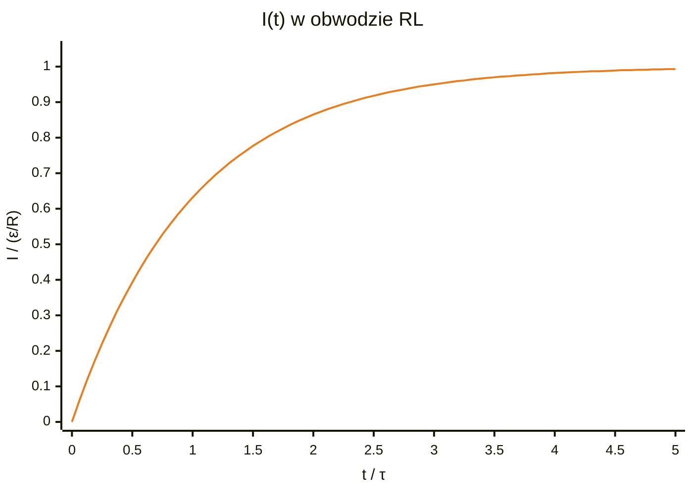
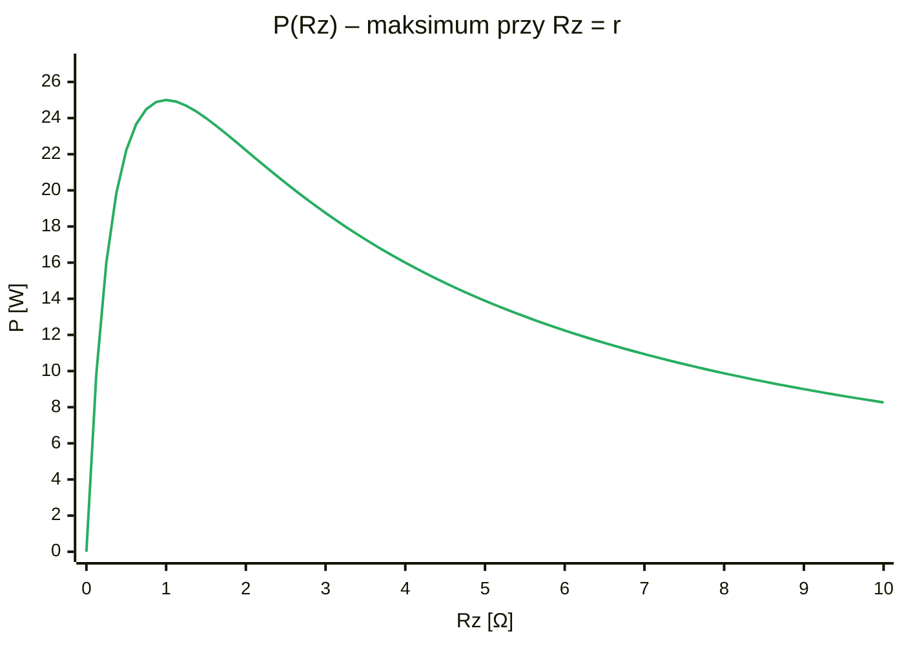

# Kolos 1 – Prąd elektryczny i magnetyzm

## 0. Zasady, które ratują punkty
> [!warning] Pamiętaj
> 1. **Wszystko w SI:** $\color{gray}{1\,\mu\text{m} = 10^{-6}\,\text{m}}$, $\color{gray}{1\,\text{nm} = 10^{-9}\,\text{m}}$, $\color{gray}{1\,\text{mm}^2 = 10^{-6}\,\text{m}^2}$, $\color{gray}{1\,\mu\Omega\cdot\text{cm} = 10^{-8}\,\Omega\cdot\text{m}}$, $\color{gray}{1\,\text{g/cm}^3 = 10^{3}\,\text{kg/m}^3}$.
> 2. Zawsze zacznij od: **co jest dane, czego szukam, jaki wzór je łączy**.
> 3. Jeśli materiał nie jest podany – zakładasz **miedź** i to piszesz.
> 4. Na końcu sprawdź jednostkę i czy wynik ma sens.

---

## 1. Zadanie z kolosa (płytka) – pełne rozwiązanie

> [!note] Oznaczenia
> - $l$ – długość płytki (wzdłuż prądu), $d$ – szerokość, $h$ – grubość [m]
> - $S = d\cdot h$ – przekrój prostopadły do prądu [m²]
> - $\rho$ – rezystywność miedzi [Ω·m], $\rho_m$ – gęstość miedzi [kg/m³]
> - $M$ – masa molowa [kg/mol], $N_A$ – liczba Avogadra
> - $j$ – gęstość prądu [A/m²], $I$ – prąd [A], $U$ – napięcie [V], $R$ – opór [Ω]
> - $n$ – liczba elektronów swobodnych w 1 m³ [m⁻³], $e$ – ładunek elementarny
> - $v$ – prędkość dryfu elektronów [m/s]


> [!info] Dane
> $\color{teal}{l = 100\,\mu\text{m} = 10^{-4}\,\text{m}}$, $\color{teal}{d = 30\,\mu\text{m} = 3\cdot10^{-5}\,\text{m}}$, $\color{teal}{h = 5\,\text{nm} = 5\cdot10^{-9}\,\text{m}}$, $\color{teal}{j = 10^{12}\,\text{A/m}^2}$.

Materiał: miedź (zakładamy) → $\color{teal}{\rho = 1{,}7\cdot10^{-8}\,\Omega\cdot\text{m}}$, $\color{teal}{\rho_m = 8960\,\text{kg/m}^3}$, $\color{teal}{M = 63{,}5\,\text{g/mol}}$.

### a) Opór
Prąd płynie wzdłuż $\color{teal}{l}$, więc przekrój to ścianka prostopadła do $\color{teal}{l}$: $\color{teal}{S = d\cdot h}$.

$$\color{royalblue} S = 3\cdot10^{-5}\cdot5\cdot10^{-9} = 1{,}5\cdot10^{-13}\ \text{m}^2$$

$$\color{royalblue} R = \rho\frac{l}{S} = 1{,}7\cdot10^{-8}\cdot\frac{10^{-4}}{1{,}5\cdot10^{-13}} \approx \boxed{\color{orange}11\ \Omega}$$

### b) Napięcie przy $\color{teal}{j = 10^{12}\,\text{A/m}^2}$
Prawo Ohma w postaci lokalnej: $\color{teal}{j = \sigma E = \dfrac{E}{\rho}}$, a $\color{teal}{E = \dfrac{U}{l}}$:

$$\color{royalblue} U = j\rho l = 10^{12}\cdot1{,}7\cdot10^{-8}\cdot10^{-4} = \boxed{\color{orange}1{,}7\ \text{V}}$$

> [!success] Sprawdzenie
> $\color{teal}{I = jS = 0{,}15\,\text{A}}$, $\color{teal}{U = IR = 0{,}15\cdot11{,}3 \approx 1{,}7\,\text{V}}$ ✔

### c) Prędkość dryfu
**Krok 1 – ile jest elektronów w m³** (1 elektron na atom → $\color{teal}{n}$ = liczba atomów w m³):

$$\color{royalblue} n = \frac{\rho_m N_A}{M} = \frac{8960\cdot6{,}02\cdot10^{23}}{0{,}0635} \approx 8{,}5\cdot10^{28}\ \text{m}^{-3}$$

> [!tip]
> masa 1 m³ / masa 1 mola = liczba moli; × $\color{teal}{N_A}$ = liczba atomów.

**Krok 2 – prędkość:** $\color{teal}{j = nev}$

$$\color{royalblue} v = \frac{j}{ne} = \frac{10^{12}}{8{,}5\cdot10^{28}\cdot1{,}6\cdot10^{-19}} \approx \boxed{\color{orange}74\ \text{m/s}}$$

(Duże, bo $\color{teal}{j}$ jest ogromne – w zwykłym kablu $\color{teal}{j \sim 10^6\,\text{A/m}^2}$, $\color{teal}{v \sim 0{,}1\,\text{mm/s}}$.)

---

## 2. Prąd – wzory

| Co | Wzór | Oznaczenia |
|---|---|---|
| Opór drutu | $\color{royalblue}{R = \rho\dfrac{l}{S}}$ | $R$ – opór [Ω], $\rho$ – rezystywność [Ω·m], $l$ – długość [m], $S$ – przekrój [m²] |
| Gęstość prądu | $\color{royalblue}{j = \dfrac{I}{S}}$ | $j$ – gęstość prądu, czyli prąd na 1 m² przekroju [A/m²] |
| Gęstość prądu przez nośniki | $\color{royalblue}{j = nev}$ | $n$ – koncentracja, $e$ – ładunek, $v$ – prędkość dryfu |
| Prawo Ohma lokalnie | $\color{royalblue}{j = \sigma E}$ | $\sigma$ – przewodność, $E$ – pole elektryczne w przewodniku [V/m] |
| Pole w drucie | $\color{royalblue}{E = \dfrac{U}{l}}$ | $E$ – pole elektryczne [V/m], $U$ – napięcie [V], $l$ – długość [m] |
| Przewodność | $\color{royalblue}{\sigma = \dfrac{1}{\rho}}$ | $\sigma$ – przewodność [S/m], odwrotność rezystywności $\rho$ |
| Prędkość dryfu | $\color{royalblue}{v = \mu E}$ | $v$ – prędkość dryfu [m/s], $\mu$ – ruchliwość, $E$ – pole elektryczne |
| Przewodność przez nośniki | $\color{royalblue}{\sigma = ne\mu}$ | $n$ – koncentracja nośników [m⁻³], $e$ – ładunek elementarny [C], $\mu$ – ruchliwość [m²/(V·s)] |
| Koncentracja elektronów | $\color{royalblue}{n = \dfrac{\rho_m N_A}{M}}$ | $\rho_m$ – gęstość [kg/m³], $N_A$ – liczba Avogadra, $M$ – masa molowa [kg/mol] (1 elektron na atom) |
| Napięcie źródła z oporem wewn. | $\color{royalblue}{V = \varepsilon - Ir}$ | $V$ – napięcie na obciążeniu [V], $\varepsilon$ – SEM [V], $I$ – prąd, $r$ – opór wewnętrzny [Ω] |
| Moc maksymalna (gdy $R = r$) | $\color{royalblue}{P_{max} = \dfrac{\varepsilon^2}{4r}}$ | $P_{max}$ – największa moc, jaką da źródło [W] |
| Amplituda a wartość skuteczna | $\color{royalblue}{U_0 = \sqrt2\,U_{sk}}$ | $U_0$ – amplituda (wartość szczytowa), $U_{sk}$ – wartość skuteczna (np. 230 V w gniazdku) |

## 3. Magnetyzm

| Co | Wzór | Oznaczenia |
|---|---|---|
| Siła Lorentza | $\color{purple}{F = qvB}$ | $F$ – siła [N], $q$ – ładunek [C], $v$ – prędkość [m/s], $B$ – indukcja [T] |
| Napięcie Halla | $\color{purple}{U_H = \dfrac{IB}{ned}}$ | $U_H$ – napięcie Halla [V], $I$ – prąd, $B$ – indukcja, $n$ – koncentracja, $d$ – grubość płytki (wzdłuż $B$) |
| Pole w środku pętli | $\color{purple}{B = \dfrac{\mu_0 I}{2R}}$ | $B$ – indukcja [T], $I$ – prąd [A], $R$ – promień pętli [m] |
| Pole prostego drutu | $\color{purple}{B = \dfrac{\mu_0 I}{2\pi r}}$ | $r$ – odległość od drutu [m], $I$ – prąd |
| Pole w solenoidzie | $\color{purple}{B = \dfrac{\mu_0 N I}{l}}$ | $N$ – liczba zwojów, $l$ – długość cewki [m], $I$ – prąd |
| Indukcyjność solenoidu | $\color{purple}{L = \dfrac{\mu_0 N^2 S}{l}}$ | $L$ – indukcyjność [H], $N$ – zwoje, $S$ – przekrój, $l$ – długość |
| Prawo Faradaya | $\color{purple}{\varepsilon = -\dfrac{d\Phi}{dt}}$ | $\varepsilon$ – SEM indukowana [V]: zmiana strumienia w czasie daje napięcie |
| Amplituda SEM ramki | $\color{purple}{\varepsilon_0 = BA\omega}$ | $\varepsilon_0$ – największa wartość SEM |
| Napięcie na cewce | $\color{purple}{U = -L\dfrac{dI}{dt}}$ | $U$ – napięcie [V], $\dfrac{dI}{dt}$ – jak szybko zmienia się prąd |

## 4. Cewka RL podłączona do $\varepsilon$
Kirchhoff (suma napięć w oczku = 0):

$$\color{royalblue} \varepsilon = IR + L\frac{dI}{dt}$$

$$\color{royalblue} I(t) = \frac{\varepsilon}{R}\left(1 - e^{-t/\tau}\right)$$

$$\color{royalblue} \tau = \frac{L}{R}$$

> [!tip]
> Prąd rośnie od 0 do $\color{green}{\varepsilon/R}$ (po $\color{green}{5\tau}$ praktycznie maksimum).



### Wykresy do źródła z oporem wewnętrznym ($\color{green}{\varepsilon = 10\,\text{V}}$, $\color{green}{r = 1\,\Omega}$)

```mermaid
%%{init: {"themeVariables": {"xyChart": {"plotColorPalette": "#2e86de"}}}}%%
xychart-beta
    title "V(I) – prosta malejąca"
    x-axis "I [A]" 0 --> 10
    y-axis "V [V]" 0 --> 10
    line [10, 9.875, 9.75, 9.625, 9.5, 9.375, 9.25, 9.125, 9, 8.875, 8.75, 8.625, 8.5, 8.375, 8.25, 8.125, 8, 7.875, 7.75, 7.625, 7.5, 7.375, 7.25, 7.125, 7, 6.875, 6.75, 6.625, 6.5, 6.375, 6.25, 6.125, 6, 5.875, 5.75, 5.625, 5.5, 5.375, 5.25, 5.125, 5, 4.875, 4.75, 4.625, 4.5, 4.375, 4.25, 4.125, 4, 3.875, 3.75, 3.625, 3.5, 3.375, 3.25, 3.125, 3, 2.875, 2.75, 2.625, 2.5, 2.375, 2.25, 2.125, 2, 1.875, 1.75, 1.625, 1.5, 1.375, 1.25, 1.125, 1, 0.875, 0.75, 0.625, 0.5, 0.375, 0.25, 0.125, 0]
```



## 5. Typowe zadania na kolosa 1 – schematy

- **Źródło + $\color{crimson}{R_z}$:** $\color{crimson}{V = \varepsilon - Ir}$ (prosta malejąca), $\color{crimson}{P = \dfrac{\varepsilon^2 R_z}{(R_z+r)^2}}$, max dla $\color{crimson}{R_z = r}$.
- **Dryf w drucie:** $\color{crimson}{E = \dfrac{U}{l}}$ → $\color{crimson}{v = \mu E}$ albo $\color{crimson}{v = \dfrac{I}{neS}}$; prąd przemienny $\color{crimson}{v_0 = \sqrt2\,v_{sk}}$; droga w pół okresu $\color{crimson}{s = \dfrac{2v_0}{\omega}}$.
- **Płytka/drut:** $\color{crimson}{R = \rho\dfrac{l}{S}}$, $\color{crimson}{U = j\rho l}$, $\color{crimson}{n = \dfrac{\rho_m N_A}{M}}$, $\color{crimson}{v = \dfrac{j}{ne}}$.
- **Hallotron:** $\color{crimson}{v = \dfrac{I}{neS}}$, $\color{crimson}{F = evB}$, $\color{crimson}{\mu = \dfrac{\sigma}{ne}}$, $\color{crimson}{U_H = \dfrac{IB}{ned}}$ – półprzewodnik, bo małe $\color{crimson}{n}$ → duże $\color{crimson}{U_H}$.
- **Pętla kompensuje pole Ziemi:** $\color{crimson}{I = \dfrac{2RB}{\mu_0}}$ ($\color{crimson}{B \approx 50\,\mu\text{T}}$ → ok. $\color{crimson}{16\,\text{A}}$ dla $\color{crimson}{R = 20\,\text{cm}}$).
- **Wirująca ramka:** $\color{crimson}{\varepsilon_0 = BA\omega}$, $\color{crimson}{R = \rho\dfrac{4a}{S}}$, $\color{crimson}{I_0 = \dfrac{\varepsilon_0}{R}}$, $\color{crimson}{\bar P = \dfrac{\varepsilon_0^2}{2R}}$.
- **Solenoid z Ampère'a:** $\color{crimson}{\oint \vec B\cdot d\vec l = \mu_0 I}$ → $\color{crimson}{BD = \mu_0 NI}$ → $\color{crimson}{B = \dfrac{\mu_0 NI}{D}}$, $\color{crimson}{\Phi = NBS}$, $\color{crimson}{L = \dfrac{\mu_0 N^2 S}{D}}$, $\color{crimson}{U = -LI_0\omega\cos\omega t}$.

## 6. Stałe
$\color{gray}{e = 1{,}6\cdot10^{-19}\,\text{C}}$, $\color{gray}{N_A = 6{,}02\cdot10^{23}\,\text{mol}^{-1}}$, $\color{gray}{\mu_0 = 4\pi\cdot10^{-7}\,\text{H/m}}$

**Miedź:** $\color{gray}{\rho = 1{,}7\cdot10^{-8}\,\Omega\cdot\text{m}}$, $\color{gray}{\rho_m = 8960\,\text{kg/m}^3}$, $\color{gray}{M = 63{,}5\,\text{g/mol}}$, $\color{gray}{n = 8{,}5\cdot10^{28}\,\text{m}^{-3}}$
