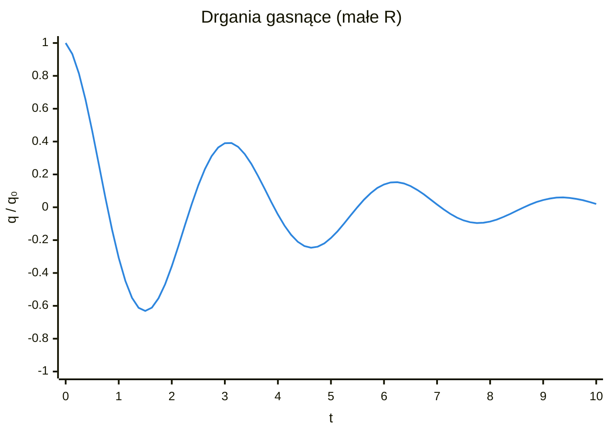
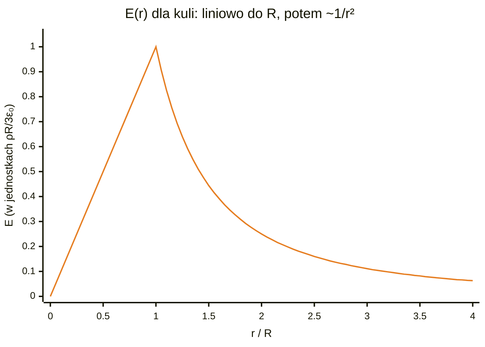

# Kolos 2 – Cewki, drgania i fale EM

## 0. Zasady, które ratują punkty
> [!warning] Pamiętaj
> 1. **Wszystko w SI:** $\color{gray}{1\,\text{cm}^2 = 10^{-4}\,\text{m}^2}$, $\color{gray}{1\,\text{mm} = 10^{-3}\,\text{m}}$, $\color{gray}{\text{średnica} \to r = d/2}$.
> 2. Obwody: zawsze zaczynasz od **II prawa Kirchhoffa** (suma napięć w oczku = 0).
> 3. Wyprowadzenia: napisz **wzór wyjściowy**, potem kroki – za same kroki są punkty.
> 4. Na końcu sprawdź jednostkę i czy wynik ma sens.

---

## 1. Obwód LC (bez oporu)

> [!note] Oznaczenia
> - $L$ – indukcyjność cewki [H], $C$ – pojemność kondensatora [F]
> - $q$ – ładunek na kondensatorze [C], $q_0$ – ładunek na początku
> - $I = \dot q$ – prąd (pochodna ładunku po czasie) [A], $\ddot q$ – druga pochodna ładunku
> - $\omega_0$ – częstość kołowa drgań własnych [rad/s], $f$ – częstotliwość [Hz]
> - $N$ – liczba zwojów, $l$ – długość cewki [m], $S$ – pole przekroju / okładki [m²]
> - $d$ – odległość okładek kondensatora [m]
> - $\varepsilon_0$ – przenikalność elektryczna próżni, $\varepsilon_r$ – przenikalność względna izolatora
> - $\mu_0$ – przenikalność magnetyczna próżni

Kirchhoff: napięcie na cewce + napięcie na kondensatorze = 0, a $\color{teal}{I = \dot q}$:

$$\color{royalblue} L\ddot q + \frac{q}{C} = 0 \;\Rightarrow\; \ddot q + \frac{1}{LC}q = 0$$

$$\color{royalblue} \boxed{\color{orange}q(t) = q_0\cos(\omega_0 t),\quad I(t) = -q_0\omega_0\sin(\omega_0 t),\quad \omega_0 = \frac{1}{\sqrt{LC}}}$$

> [!tip]
> To oscylator harmoniczny, jak sprężyna. Energia przelewa się między kondensatorem (pole $\color{teal}{E}$) a cewką (pole $\color{teal}{B}$).

**Potrzebne wzory do liczb:**

$$\color{royalblue} L = \frac{\mu_0 N^2 S}{l},\qquad C = \frac{\varepsilon_0\varepsilon_r S}{d},\qquad f = \frac{\omega_0}{2\pi}$$

> [!example] Przykład z zestawu
> $\color{teal}{N = 100}$, $\color{teal}{l = 10\,\text{cm}}$, średnica $\color{teal}{0{,}4\,\text{cm}}$ → $\color{teal}{L \approx 1{,}58\,\mu\text{H}}$
> $\color{teal}{S = 1\,\text{cm}^2}$, $\color{teal}{d = 0{,}5\,\text{mm}}$, $\color{teal}{\varepsilon_r = 4}$ → $\color{teal}{C \approx 7{,}1\,\text{pF}}$
> $\color{teal}{\omega_0 \approx 3\cdot10^{8}\,\text{rad/s}}$, $\color{teal}{f \approx 48\,\text{MHz}}$

---

## 2. Obwód RLC (gasnące drgania)

> [!note] Oznaczenia
> - $R$ – opór [Ω], $L$ – indukcyjność [H], $C$ – pojemność [F]
> - $\beta = R/(2L)$ – współczynnik tłumienia: jak szybko drgania gasną [1/s]
> - $\omega_0 = 1/\sqrt{LC}$ – częstość drgań bez oporu [rad/s]
> - $\omega$ – częstość drgań tłumionych [rad/s]
> - $\lambda$ – pierwiastki równania charakterystycznego
> - $A, B$ – stałe zależne od warunków początkowych

$$\color{royalblue} L\ddot q + R\dot q + \frac{q}{C} = 0 \;\Rightarrow\; \ddot q + 2\beta\dot q + \omega_0^2 q = 0,\qquad \beta = \frac{R}{2L}$$

Zgadujemy $\color{green}{q = e^{\lambda t}}$ → $\color{green}{\lambda = -\beta \pm \sqrt{\beta^2 - \omega_0^2}}$

| Przypadek | Warunek | Rozwiązanie |
|---|---|---|
| małe $R$ | $\color{green}{\beta < \omega_0}$ | $\color{orange}{q = q_0 e^{-\beta t}\cos(\omega t),\ \omega = \sqrt{\omega_0^2 - \beta^2}}$ |
| krytyczne | $\color{green}{R = 2\sqrt{L/C}}$ | $\color{orange}{q = q_0(1 + \beta t)e^{-\beta t}}$ |
| duże $R$ | $\color{green}{R > 2\sqrt{L/C}}$ | $\color{orange}{q = Ae^{\lambda_1 t} + Be^{\lambda_2 t}}$, bez drgań |

---

## 3. RLC z wymuszeniem (zadanie z symulacją)

> [!note] Oznaczenia
> - $U_0$ – amplituda napięcia źródła [V]
> - $\Omega$ – częstość kołowa źródła [rad/s]
> - $Z$ – impedancja, czyli „opór zastępczy” obwodu [Ω]
> - $I_0$ – amplituda prądu po ustabilizowaniu [A]
> - $\varphi$ – przesunięcie fazowe prądu względem napięcia
> - $\Delta t$ – krok czasu w symulacji [s]

$$\color{royalblue} L\frac{dI}{dt} + RI + \frac{q}{C} = U_0\sin(\Omega t)$$

Po ustabilizowaniu prąd drga z częstotliwością **źródła**:

$$\color{royalblue} \boxed{\color{orange}I_0 = \frac{U_0}{Z},\quad Z = \sqrt{R^2 + \left(\Omega L - \frac{1}{\Omega C}\right)^2},\quad \operatorname{tg}\varphi = \frac{\Omega L - \frac{1}{\Omega C}}{R}}$$

- $\color{green}{\Omega < \omega_0}$ → przeważa kondensator → prąd **wyprzedza** napięcie
- $\color{green}{\Omega > \omega_0}$ → przeważa cewka → prąd **spóźnia się**
- $\color{green}{\Omega = \omega_0}$ → **rezonans**: $\color{green}{Z = R}$, prąd max, faza 0

> [!tip] Metoda Eulera (jak działa symulator)
> W każdym kroku $\color{teal}{\Delta t}$: $\color{teal}{\frac{dI}{dt} = \frac{U - RI - q/C}{L}}$, potem $\color{teal}{I \leftarrow I + \frac{dI}{dt}\Delta t}$, $\color{teal}{q \leftarrow q + I\Delta t}$.

---

## 4. Fala: $E = E_0\sin(kx - \omega t)$

> [!note] Oznaczenia
> - $E_0$ – amplituda pola elektrycznego [V/m]
> - $k$ – liczba falowa [m⁻¹], $x$ – położenie [m], $t$ – czas [s]
> - $\lambda$ – długość fali [m], $T$ – okres [s]
> - $\omega$ – częstość kołowa [rad/s], $c$ – prędkość światła [m/s]
> - $\Delta x$ – przesunięcie odpowiadające zmianie fazy [m]

| Wielkość | Wzór | Dla $k = 10^{10}\,\text{m}^{-1}$ |
|---|---|---|
| długość fali | $\color{crimson}{\lambda = 2\pi/k}$ | $\color{orange}{0{,}63\,\text{nm}}$ |
| częstość | $\color{crimson}{\omega = ck}$ | $\color{orange}{3\cdot10^{18}\,\text{rad/s}}$ |
| okres | $\color{crimson}{T = 2\pi/\omega}$ | $\color{orange}{2{,}1\cdot10^{-18}\,\text{s}}$ |
| faza o $90^\circ$ | $\color{crimson}{\Delta x = \frac{\pi}{2k} = \frac{\lambda}{4}}$ | $\color{orange}{1{,}57\cdot10^{-10}\,\text{m}}$ |

---

## 5. Pole naładowanej kuli (prawo Gaussa)

> [!note] Oznaczenia
> - $\rho$ – gęstość objętościowa ładunku [C/m³]
> - $R$ – promień kuli [m], $r$ – odległość od środka [m]
> - $Q_{wewn}$ – ładunek wewnątrz sfery Gaussa [C]
> - $E$ – natężenie pola [V/m], $E_r$ – jego składowa radialna
> - $\nabla\cdot\vec E$ – dywergencja (czy są źródła), $\nabla\times\vec E$ – rotacja (czy pole wiruje)

$$\color{royalblue} \oint \vec E\cdot d\vec S = \frac{Q_{wewn}}{\varepsilon_0} \;\Rightarrow\; E\cdot4\pi r^2 = \frac{Q_{wewn}}{\varepsilon_0}$$

| Gdzie | $Q_{wewn}$ | $E(r)$ | $\nabla\cdot\vec E$ | $\nabla\times\vec E$ |
|---|---|---|---|---|
| $r < R$ | $\color{darkorange}{\rho\frac43\pi r^3}$ | $\color{orange}{\dfrac{\rho r}{3\varepsilon_0}}$ | $\color{darkorange}{\rho/\varepsilon_0}$ | $0$ |
| $r > R$ | $\color{darkorange}{\rho\frac43\pi R^3}$ | $\color{orange}{\dfrac{\rho R^3}{3\varepsilon_0 r^2}}$ | $0$ | $0$ |

Dywergencja w sferycznych (tylko składowa $E_r$):

$$\color{royalblue} \nabla\cdot\vec E = \frac{1}{r^2}\frac{\partial}{\partial r}\left(r^2 E_r\right)$$

> [!tip]
> Rotacja = 0, bo pole jest tylko radialne i zależy tylko od $\color{teal}{r}$ (pole elektrostatyczne jest bezwirowe).

---

## 6. Równania Maxwella

> [!note] Oznaczenia
> - $\vec E$ – pole elektryczne [V/m], $\vec B$ – pole magnetyczne [T]
> - $\rho$ – gęstość ładunku [C/m³], $\vec j$ – gęstość prądu [A/m²]
> - $Q$ – ładunek [C], $I$ – prąd [A]
> - $\Phi_E, \Phi_B$ – strumienie pola elektrycznego i magnetycznego
> - $d\vec S$ – kawałek powierzchni, $d\vec l$ – kawałek krzywej
> - $\varepsilon_0, \mu_0$ – stałe próżni

| | Całkowa | Różniczkowa | Po ludzku |
|---|---|---|---|
| I | $\color{mediumvioletred}{\oint \vec E\cdot d\vec S = \dfrac{Q}{\varepsilon_0}}$ | $\color{mediumvioletred}{\nabla\cdot\vec E = \dfrac{\rho}{\varepsilon_0}}$ | ładunki są źródłem $E$ |
| II | $\color{mediumvioletred}{\oint \vec B\cdot d\vec S = 0}$ | $\color{mediumvioletred}{\nabla\cdot\vec B = 0}$ | brak „ładunków magnetycznych” |
| III | $\color{mediumvioletred}{\oint \vec E\cdot d\vec l = -\dfrac{d\Phi_B}{dt}}$ | $\color{mediumvioletred}{\nabla\times\vec E = -\dfrac{\partial\vec B}{\partial t}}$ | zmienne $B$ robi wirowe $E$ |
| IV | $\color{mediumvioletred}{\oint \vec B\cdot d\vec l = \mu_0 I + \mu_0\varepsilon_0\dfrac{d\Phi_E}{dt}}$ | $\color{mediumvioletred}{\nabla\times\vec B = \mu_0\vec j + \mu_0\varepsilon_0\dfrac{\partial\vec E}{\partial t}}$ | prąd i zmienne $E$ robią wirowe $B$ |

> [!info] Prąd przesunięcia
> $\color{teal}{\varepsilon_0\frac{\partial\vec E}{\partial t}}$ – zmienne pole $E$ działa jak prąd (np. między okładkami kondensatora). Bez niego nie byłoby fal EM.

> [!warning] W próżni
> $\color{teal}{\rho = 0}$ i $\color{teal}{\vec j = 0}$ → znikają człony z ładunkiem i prądem.

---

## 7. Równanie falowe – wyprowadzenie w 3 krokach

> [!note] Oznaczenia
> - $\nabla\times$ – rotacja, $\nabla\cdot$ – dywergencja
> - $\nabla^2$ – laplasjan: suma drugich pochodnych po $x, y, z$
> - $v$ – prędkość fali [m/s], $c$ – prędkość światła [m/s]

Tożsamość: $\color{green}{\nabla\times(\nabla\times\vec E) = \nabla(\nabla\cdot\vec E) - \nabla^2\vec E}$

1. Rotacja z III równania: $\color{green}{\nabla\times(\nabla\times\vec E) = -\frac{\partial}{\partial t}(\nabla\times\vec B)}$
2. Lewa strona: $\color{green}{\nabla\cdot\vec E = 0}$ w próżni → zostaje $\color{green}{-\nabla^2\vec E}$
3. Prawa strona: wstawiamy IV równanie → $\color{green}{-\mu_0\varepsilon_0\frac{\partial^2\vec E}{\partial t^2}}$

$$\color{royalblue} \boxed{\color{orange}\nabla^2\vec E = \mu_0\varepsilon_0\frac{\partial^2\vec E}{\partial t^2}},\qquad v = \frac{1}{\sqrt{\mu_0\varepsilon_0}} = c$$

---

## 8. Sprawdzenie fali $\vec E = \hat j E_0\sin(\omega t - kx)$

> [!note] Oznaczenia
> - $\hat j$ – wektor jednostkowy osi $y$
> - $E_0$ – amplituda, $\omega$ – częstość kołowa, $k$ – liczba falowa
> - $v = \omega/k$ – prędkość fali [m/s]
> - $\varepsilon_r, \mu_r$ – przenikalności względne ośrodka

$$\color{royalblue} \frac{\partial^2 E}{\partial x^2} = -k^2 E,\qquad \frac{\partial^2 E}{\partial t^2} = -\omega^2 E \;\Rightarrow\; k^2 = \mu_0\varepsilon_0\omega^2$$

> [!success] Wniosek
> Spełnia równanie, gdy $\color{teal}{v = \frac{\omega}{k} = c}$. W ośrodku $\color{teal}{v = \frac{c}{\sqrt{\varepsilon_r\mu_r}}}$ – prędkość zależy tylko od ośrodka.

---

## 9. Pole $B$ tej fali i $\vec E\times\vec B$

> [!note] Oznaczenia
> - $\hat i, \hat j, \hat k$ – wektory jednostkowe osi $x, y, z$
> - $E_y$ – składowa pola elektrycznego, $B_z$ – składowa pola magnetycznego
> - $B_0 = E_0/c$ – amplituda pola magnetycznego [T]
> - $\vec S$ – wektor Poyntinga: energia niesiona przez 1 m² w 1 s [W/m²]

Z prawa Faradaya: $\color{green}{(\nabla\times\vec E)_z = \frac{\partial E_y}{\partial x} = -kE_0\cos(\omega t - kx) = -\frac{\partial B_z}{\partial t}}$

$$\color{royalblue} \boxed{\color{orange}\vec B = \hat k\,\frac{E_0}{c}\sin(\omega t - kx)}$$

$$\color{royalblue} \vec E\times\vec B = \frac{E_0^2}{c}\sin^2(\omega t - kx)\,\hat i$$

> [!tip]
> $\color{teal}{\vec B \perp \vec E}$, drgają w fazie, $\color{teal}{B_0 = E_0/c}$. Iloczyn $\color{teal}{\vec E\times\vec B}$ jest $\color{teal}{\sim E_0^2}$, skierowany w $\color{teal}{+x}$ (w stronę ruchu fali). $\color{teal}{\vec S = \frac{1}{\mu_0}\vec E\times\vec B}$ to wektor Poyntinga.

---

## 10. Stałe
$\color{gray}{\varepsilon_0 = 8{,}85\cdot10^{-12}\,\text{F/m}}$, $\color{gray}{\mu_0 = 4\pi\cdot10^{-7}\,\text{H/m}}$, $\color{gray}{c = 3\cdot10^{8}\,\text{m/s}}$
