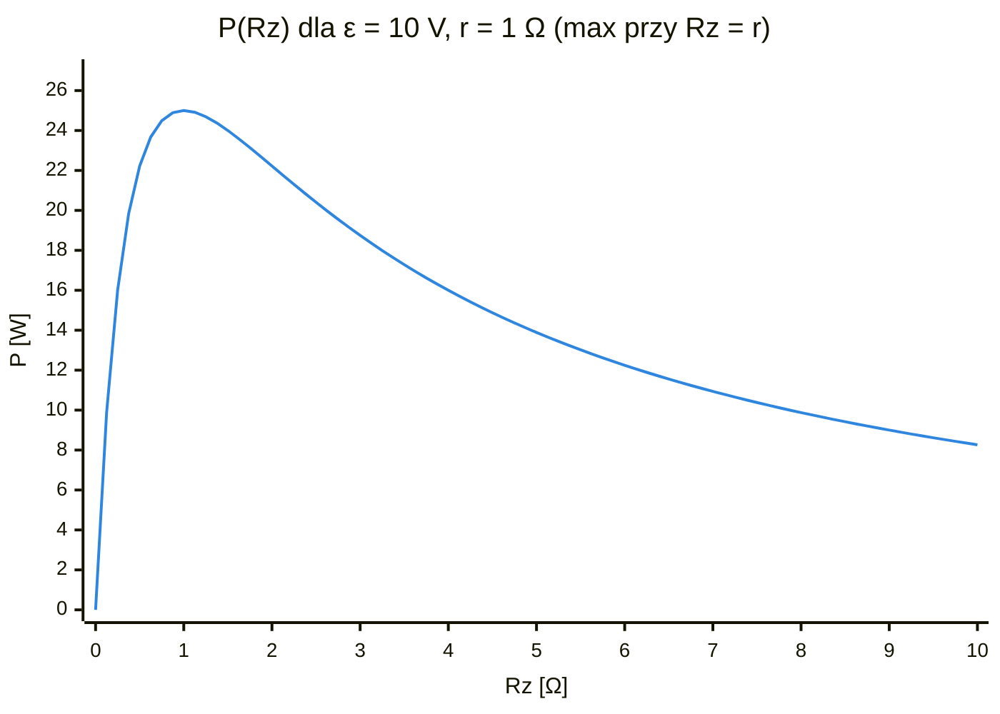
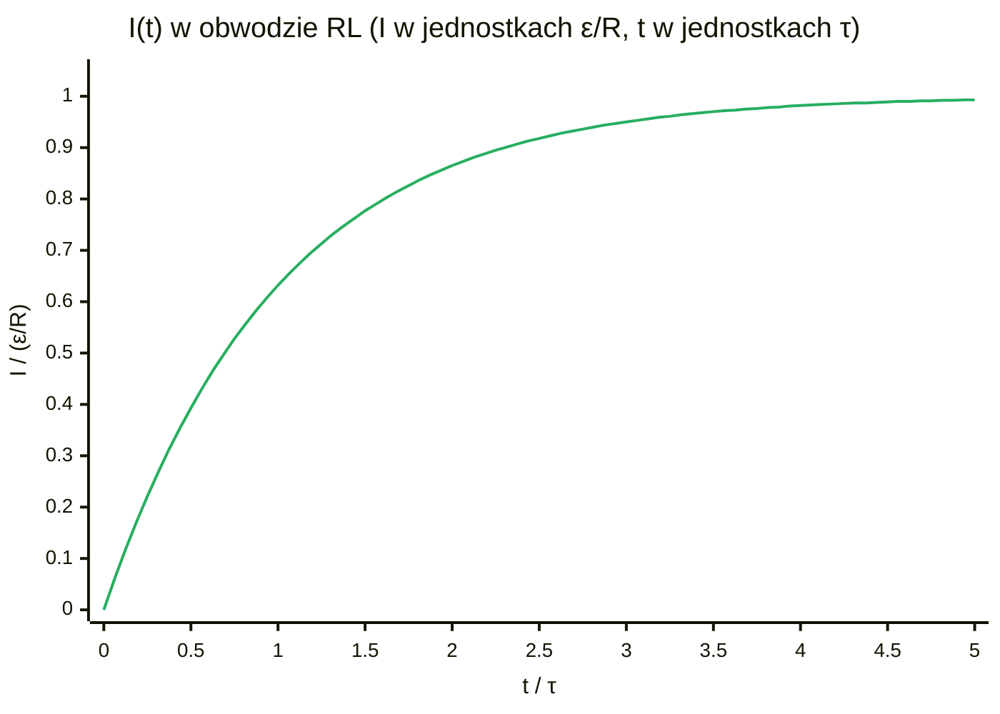

# Zestaw 1 – Prąd elektryczny. Magnetyzm (rozwiązania „krok po kroku”)

> [!warning] Zasada ogólna
> **najpierw rozumiesz, co się dzieje fizycznie, potem piszesz wzór, potem wstawiasz liczby.** Jednostki zawsze w SI (metry, a nie cm!).

---

## Zadanie 1 – Zasilacz z oporem wewnętrznym + zmienny rezystor

> [!note] Oznaczenia
> - $\varepsilon$ – siła elektromotoryczna (SEM) zasilacza, czyli napięcie „bez obciążenia” [V]
> - $r$ – opór wewnętrzny zasilacza (ukryty w środku) [Ω]
> - $R_z$ – opór zmiennego rezystora, czyli obciążenia [Ω]
> - $I$ – natężenie prądu płynącego w obwodzie [A]
> - $V$ – napięcie na obciążeniu (to, co „dociera” do odbiornika) [V]
> - $P$ – moc użyteczna, wydzielana na obciążeniu [W]


### Co tu się dzieje?
Każda bateria/zasilacz ma w środku „ukryty” opornik $r$. Prąd płynie w kółko: przez $r$ (w środku zasilacza) i przez $R_z$ (na zewnątrz). Część napięcia „gubi się” w środku.

### II prawo Kirchhoffa (po ludzku)
Idąc dookoła obwodu, suma „dodanych” napięć = suma „zużytych”:

$$\color{royalblue} \varepsilon = I r + I R_z$$

### a) Napięcie na obciążeniu $V$ od prądu $I$
Na obciążeniu jest to, co zostało po stracie w środku:

$$\color{royalblue} V = I R_z = \varepsilon - I r$$

> [!tip]
> To **prosta malejąca**: dla $\color{teal}{I = 0}$ → $\color{teal}{V = \varepsilon}$ (zasilacz bez obciążenia), dla $\color{teal}{V = 0}$ → $\color{teal}{I = \varepsilon/r}$ (zwarcie, prąd maksymalny).

```mermaid
%%{init: {"themeVariables": {"xyChart": {"plotColorPalette": "#e67e22"}}}}%%
xychart-beta
    title "V(I) dla ε = 10 V, r = 1 Ω"
    x-axis "I [A]" 0 --> 10
    y-axis "V [V]" 0 --> 10
    line [10, 9.875, 9.75, 9.625, 9.5, 9.375, 9.25, 9.125, 9, 8.875, 8.75, 8.625, 8.5, 8.375, 8.25, 8.125, 8, 7.875, 7.75, 7.625, 7.5, 7.375, 7.25, 7.125, 7, 6.875, 6.75, 6.625, 6.5, 6.375, 6.25, 6.125, 6, 5.875, 5.75, 5.625, 5.5, 5.375, 5.25, 5.125, 5, 4.875, 4.75, 4.625, 4.5, 4.375, 4.25, 4.125, 4, 3.875, 3.75, 3.625, 3.5, 3.375, 3.25, 3.125, 3, 2.875, 2.75, 2.625, 2.5, 2.375, 2.25, 2.125, 2, 1.875, 1.75, 1.625, 1.5, 1.375, 1.25, 1.125, 1, 0.875, 0.75, 0.625, 0.5, 0.375, 0.25, 0.125, 0]
```

### b) Moc użyteczna od $R_z$
Prąd: $I = \dfrac{\varepsilon}{R_z + r}$, moc na obciążeniu:

$$\color{royalblue} P = I^2 R_z = \frac{\varepsilon^2 R_z}{(R_z + r)^2}$$

### c) Kiedy moc max?
Liczymy pochodną po $R_z$ i przyrównujemy do zera:

$$\color{royalblue} \frac{dP}{dR_z} = \varepsilon^2 \frac{(R_z+r)^2 - 2R_z(R_z+r)}{(R_z+r)^4} = 0 \Rightarrow R_z + r = 2R_z \Rightarrow \boxed{\color{orange}R_z = r}$$

$$\color{royalblue} P_{max} = \frac{\varepsilon^2}{4r}$$

> [!tip]
> **Dopasowanie obciążenia**: moc jest największa, gdy opór zewnętrzny = wewnętrzny.
> Wykres $\color{teal}{P(R_z)}$: zaczyna od 0, rośnie, szczyt w $\color{teal}{R_z = r}$, potem powoli spada do 0.



---

## Zadanie 2 – Prędkość unoszenia elektronów w miedzi

> [!note] Oznaczenia
> - $L$ – długość drutu [m]
> - $S$ – pole przekroju drutu [m²]
> - $U$ – napięcie skuteczne przyłożone do drutu [V]
> - $f$ – częstotliwość prądu [Hz], $\omega = 2\pi f$ – częstość kołowa [rad/s]
> - $\rho$ – rezystywność (opór właściwy) miedzi [Ω·m]
> - $\sigma = 1/\rho$ – przewodność właściwa [S/m]
> - $n$ – koncentracja elektronów swobodnych (ile ich jest w 1 m³) [m⁻³]
> - $e$ – ładunek elementarny, $1{,}6\cdot10^{-19}\,\text{C}$
> - $E$ – natężenie pola elektrycznego w drucie [V/m]
> - $\mu$ – ruchliwość elektronów (jak łatwo pole je „pcha”) [m²/(V·s)]
> - $v$ – prędkość unoszenia (dryfu) elektronów [m/s], $v_0$ – jej amplituda
> - $T$ – okres prądu [s], $s$ – droga elektronu w pół okresu [m]


> [!info] Dane
> $\color{teal}{L = 10\,\text{m}}$, $\color{teal}{S = 2{,}5\,\text{mm}^2 = 2{,}5\cdot10^{-6}\,\text{m}^2}$, $\color{teal}{U = 250\,\text{V}}$ (skuteczne), $\color{teal}{f = 50\,\text{Hz}}$, $\color{teal}{\rho = 1{,}7\,\mu\Omega\cdot\text{cm} = 1{,}7\cdot10^{-8}\,\Omega\cdot\text{m}}$.

Koncentracja elektronów w miedzi (z tablic): $n \approx 8{,}5\cdot10^{28}\,\text{m}^{-3}$ (1 wolny elektron na atom).

### Idea
Elektrony nie lecą z prędkością światła! Pole elektryczne tylko powoli je „pcha” – to **prędkość unoszenia (dryfu)**.

### Krok 1 – pole elektryczne w drucie
$$\color{royalblue} E = \frac{U}{L} = \frac{250}{10} = 25\ \text{V/m}$$

### Krok 2 – ruchliwość (jak łatwo elektron daje się pchać)
Przewodność $\sigma = \dfrac{1}{\rho} = 5{,}88\cdot10^{7}\,\text{S/m}$, a $\sigma = ne\mu$, więc:

$$\color{royalblue} \mu = \frac{\sigma}{n e} = \frac{5{,}88\cdot10^7}{8{,}5\cdot10^{28}\cdot1{,}6\cdot10^{-19}} \approx 4{,}3\cdot10^{-3}\ \frac{\text{m}^2}{\text{V}\cdot\text{s}}$$

### Krok 3 – prędkość unoszenia
$$\color{royalblue} v = \mu E = 4{,}3\cdot10^{-3}\cdot 25 \approx 0{,}11\ \text{m/s}\ (\text{skuteczna})$$

Amplituda (prąd przemienny, wartość szczytowa $= \sqrt2\,\cdot$ skuteczna):

$$\color{royalblue} v_0 = \sqrt2 \cdot 0{,}11 \approx 0{,}15\ \text{m/s}$$

> [!success] Sprawdzenie
> $R = \dfrac{\rho L}{S} = 0{,}068\,\Omega$, $I = \dfrac{U}{R} \approx 3700\,\text{A}$, $v = \dfrac{I}{neS} \approx 0{,}11\,\text{m/s}$ ✔. Prąd absurdalnie duży – to praktycznie zwarcie, ale liczby się zgadzają.

### Krok 4 – droga w pół okresu
Prędkość zmienia się jak sinus: $v(t) = v_0\sin(\omega t)$, $\omega = 2\pi f = 314\,\text{rad/s}$. Przez pół okresu elektron jedzie w jedną stronę:

$$\color{royalblue} s = \int_0^{T/2} v_0 \sin(\omega t)\,dt = \frac{2 v_0}{\omega} = \frac{2\cdot0{,}15}{314} \approx 1\ \text{mm}$$

> [!tip]
> Elektron w gniazdku „kiwa się” tam i z powrotem o ok. **1 mm**. Energia płynie polem, nie elektronami.

---

## Zadanie 3 – Hallotron (półprzewodnik w polu magnetycznym)

> [!note] Oznaczenia
> - $w$ – szerokość płytki, $d$ – grubość płytki [m]
> - $S = w\cdot d$ – przekrój, przez który płynie prąd [m²]
> - $I$ – prąd płynący przez płytkę [A]
> - $B$ – indukcja pola magnetycznego [T]
> - $n$ – koncentracja nośników prądu [m⁻³]
> - $\sigma$ – przewodność właściwa [(Ω·m)⁻¹]
> - $v$ – prędkość nośników [m/s]
> - $F$ – siła Lorentza działająca na jeden nośnik [N]
> - $\mu$ – ruchliwość nośników [m²/(V·s)]
> - $U_H$ – napięcie Halla (powstaje w poprzek płytki) [V]


> [!info] Dane
> długość $\color{teal}{1\,\text{cm}}$, szerokość $\color{teal}{w = 4\,\text{mm}}$, grubość $\color{teal}{d = 1\,\text{mm}}$, $\color{teal}{I = 10\,\text{mA}}$, $\color{teal}{B = 0{,}5\,\text{T}}$, $\color{teal}{n = 10^{22}\,\text{m}^{-3}}$, $\color{teal}{\sigma = 120\,(\Omega\cdot\text{m})^{-1}}$.

### Krok 1 – przekrój, przez który płynie prąd
$$\color{royalblue} S = w\cdot d = 4\cdot10^{-3}\cdot 1\cdot10^{-3} = 4\cdot10^{-6}\ \text{m}^2$$

### Krok 2 – prędkość nośników
Prąd = (ile nośników) × (ładunek) × (prędkość) × (przekrój):

$$\color{royalblue} v = \frac{I}{n e S} = \frac{0{,}01}{10^{22}\cdot1{,}6\cdot10^{-19}\cdot4\cdot10^{-6}} \approx 1{,}56\ \text{m/s}$$

### Krok 3 – siła Lorentza
$$\color{royalblue} F = e v B = 1{,}6\cdot10^{-19}\cdot1{,}56\cdot0{,}5 \approx 1{,}25\cdot10^{-19}\ \text{N}$$

### Krok 4 – ruchliwość
$$\color{royalblue} \mu = \frac{\sigma}{n e} = \frac{120}{10^{22}\cdot1{,}6\cdot10^{-19}} = 0{,}075\ \frac{\text{m}^2}{\text{V}\cdot\text{s}}$$

Bonus – napięcie Halla:

$$\color{royalblue} U_H = \frac{IB}{ned} = \frac{0{,}01\cdot0{,}5}{10^{22}\cdot1{,}6\cdot10^{-19}\cdot10^{-3}} \approx 3\ \text{mV}$$

### Dlaczego z półprzewodników?
$U_H \sim \dfrac{1}{n}$. W metalu $n \approx 10^{29}\,\text{m}^{-3}$, w półprzewodniku $10^{22}\,\text{m}^{-3}$ → **napięcie Halla miliony razy większe**, łatwe do zmierzenia. Mało nośników = każdy musi pędzić szybciej = mocniej go siła Lorentza zbacza.

---

## Zadanie 4 – Pole w środku pętli (Biot–Savart)

> [!note] Oznaczenia
> - $\mu_0 = 4\pi\cdot10^{-7}\,\text{H/m}$ – przenikalność magnetyczna próżni (stała)
> - $I$ – prąd w pętli [A]
> - $dl$ – mały kawałek drutu [m]
> - $r$ – odległość od kawałka drutu do punktu, w którym liczymy pole [m]
> - $\alpha$ – kąt między kawałkiem drutu a kierunkiem do tego punktu
> - $R$ – promień pętli [m]
> - $B$ – indukcja pola magnetycznego [T]


### Wzór Biota–Savarta
Kawałek drutu $dl$ z prądem $I$ robi w odległości $r$ pole:

$$\color{royalblue} dB = \frac{\mu_0 I}{4\pi}\frac{dl \sin\alpha}{r^2}$$

### W środku pętli
- każdy kawałek drutu jest w odległości $R$,
- kąt między $dl$ a kierunkiem do środka $= 90^\circ$, $\sin\alpha = 1$,
- wszystkie kawałki dają pole **w tę samą stronę** (prostopadle do pętli) → po prostu sumujemy.

$$\color{royalblue} B = \frac{\mu_0 I}{4\pi R^2}\oint dl = \frac{\mu_0 I}{4\pi R^2}\cdot 2\pi R = \boxed{\color{orange}\frac{\mu_0 I}{2R}}$$

### Kompensacja pola Ziemi
$B_{Ziemi} \approx 50\,\mu\text{T} = 5\cdot10^{-5}\,\text{T}$, $R = 0{,}2\,\text{m}$:

$$\color{royalblue} I = \frac{2RB}{\mu_0} = \frac{2\cdot0{,}2\cdot5\cdot10^{-5}}{4\pi\cdot10^{-7}} \approx 16\ \text{A}$$

---

## Zadanie 5 – Wirująca ramka (prądnica)

> [!note] Oznaczenia
> - $a$ – bok kwadratowej ramki [m], $A = a^2$ – pole ramki [m²]
> - $S$ – pole przekroju drutu [m²], $l = 4a$ – długość drutu [m]
> - $\rho$ – rezystywność stali [Ω·m]
> - $B$ – indukcja pola magnetycznego [T]
> - $\omega$ – prędkość kątowa obrotu ramki [rad/s]
> - $\Phi$ – strumień pola magnetycznego przez ramkę [Wb]
> - $\varepsilon(t)$ – SEM indukowana w ramce, $\varepsilon_0$ – jej amplituda [V]
> - $R$ – opór ramki [Ω], $I_0$ – maksymalny prąd [A]
> - $\bar P$ – średnia moc wydzielana jako ciepło [W]


> [!info] Dane
> $\color{teal}{a = 4\,\text{cm}}$, $\color{teal}{S_{drutu} = 1\,\text{mm}^2 = 10^{-6}\,\text{m}^2}$, $\color{teal}{\rho = 10\,\mu\Omega\cdot\text{cm} = 10^{-7}\,\Omega\cdot\text{m}}$, $\color{teal}{B = 0{,}5\,\text{T}}$, $\color{teal}{\omega = 300\,\text{rad/s}}$.

### Krok 1 – strumień przez ramkę
Ramka się kręci, więc kąt między polem a ramką zmienia się:

$$\color{royalblue} \Phi(t) = BA\cos(\omega t),\qquad A = a^2 = 1{,}6\cdot10^{-3}\ \text{m}^2$$

### Krok 2 – SEM (prawo Faradaya: napięcie = minus szybkość zmiany strumienia)
$$\color{royalblue} \varepsilon(t) = -\frac{d\Phi}{dt} = B A \omega \sin(\omega t)$$
$$\color{royalblue} \varepsilon_0 = 0{,}5\cdot1{,}6\cdot10^{-3}\cdot300 = 0{,}24\ \text{V}$$

### Krok 3 – opór ramki
Długość drutu = obwód $= 4a = 0{,}16\,\text{m}$:

$$\color{royalblue} R = \rho\frac{l}{S} = 10^{-7}\cdot\frac{0{,}16}{10^{-6}} = 0{,}016\ \Omega$$

### Krok 4 – prąd maksymalny
$$\color{royalblue} I_0 = \frac{\varepsilon_0}{R} = \frac{0{,}24}{0{,}016} = 15\ \text{A}$$

### Krok 5 – średnia moc
Średnia z $\sin^2$ wynosi $\tfrac12$:

$$\color{royalblue} \bar P = \frac{\varepsilon_0^2}{2R} = \frac{0{,}0576}{0{,}032} = 1{,}8\ \text{W}$$

---

## Zadanie 6 – Cewka (solenoid) z prawa Ampère'a

> [!note] Oznaczenia
> - $N$ – liczba zwojów cewki
> - $D$ – długość cewki [m]
> - $S$ – pole przekroju cewki [m²]
> - $I$ – prąd płynący przez cewkę [A], $I_0$ – amplituda prądu przemiennego
> - $B$ – indukcja pola wewnątrz cewki [T]
> - $\Phi$ – strumień pola przez wszystkie zwoje [Wb]
> - $L$ – indukcyjność cewki [H]
> - $\omega$ – częstość kołowa prądu [rad/s]
> - $U$ – napięcie indukowane na cewce [V]


### Prawo Ampère'a
$$\color{royalblue} \oint \vec B\cdot d\vec l = \mu_0 I_{obj}$$

„Idziesz po zamkniętej pętli, sumujesz pole wzdłuż drogi $= \mu_0\,\times$ prąd, który przebija tę pętlę.”

### Pętla prostokątna
Bierzemy prostokąt: jeden bok (długość $D$) **w środku** cewki, drugi na zewnątrz (tam $B \approx 0$), boki prostopadłe ($\vec B \perp d\vec l$ → 0). Prostokąt przebija $N$ zwojów, każdy z prądem $I$:

$$\color{royalblue} B D = \mu_0 N I \Rightarrow \boxed{\color{orange}B = \frac{\mu_0 N I}{D}}$$

### Strumień
Przez jeden zwój: $\Phi_1 = BS$. Przez wszystkie $N$ zwojów (strumień skojarzony):

$$\color{royalblue} \Phi = N B S = \frac{\mu_0 N^2 S I}{D}$$

### Indukcyjność ($\Phi = LI$)
$$\color{royalblue} \boxed{\color{orange}L = \frac{\mu_0 N^2 S}{D}}$$

### Napięcie indukowane dla $I(t) = I_0\sin(\omega t)$
$$\color{royalblue} U = -L\frac{dI}{dt} = -L I_0 \omega \cos(\omega t)$$

> [!tip]
> Amplituda rośnie z częstotliwością, napięcie przesunięte o $\color{teal}{90^\circ}$ względem prądu.

---

## Zadanie 7 – Włączanie cewki RL do źródła $\varepsilon$

> [!note] Oznaczenia
> - $\varepsilon$ – SEM źródła [V]
> - $R$ – opór cewki [Ω]
> - $L$ – indukcyjność cewki [H]
> - $I(t)$ – prąd w chwili $t$ [A]
> - $\tau = L/R$ – stała czasowa: po tym czasie prąd ma ok. 63% maksimum [s]


### Kirchhoff
$$\color{royalblue} \varepsilon = IR + L\frac{dI}{dt}$$

### Rozwiązanie (rozdzielamy zmienne)
$$\color{royalblue} \frac{dI}{\varepsilon/R - I} = \frac{R}{L}dt \Rightarrow -\ln\left(\frac{\varepsilon}{R}-I\right) = \frac{R}{L}t + C$$

Warunek: $I(0) = 0$ (cewka „nie lubi” nagłych zmian prądu):

$$\color{royalblue} \boxed{\color{orange}I(t) = \frac{\varepsilon}{R}\left(1 - e^{-t/\tau}\right),\quad \tau = \frac{L}{R}}$$

> [!tip]
> Prąd rośnie od 0 do $\color{teal}{\varepsilon/R}$ jak „nasycanie się”; po czasie $\color{teal}{\tau}$ jest ok. 63% maksimum, po $\color{teal}{5\tau}$ praktycznie 100%.


