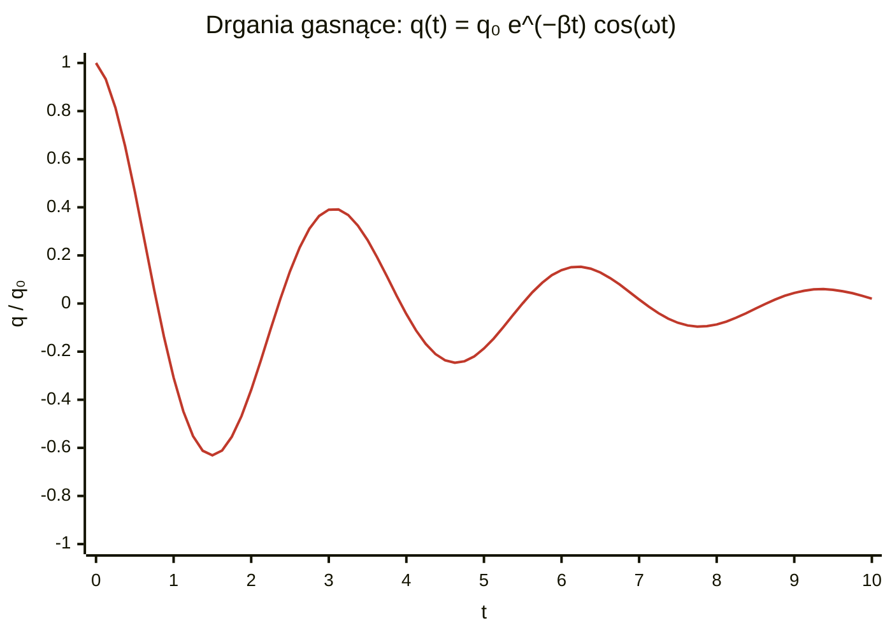
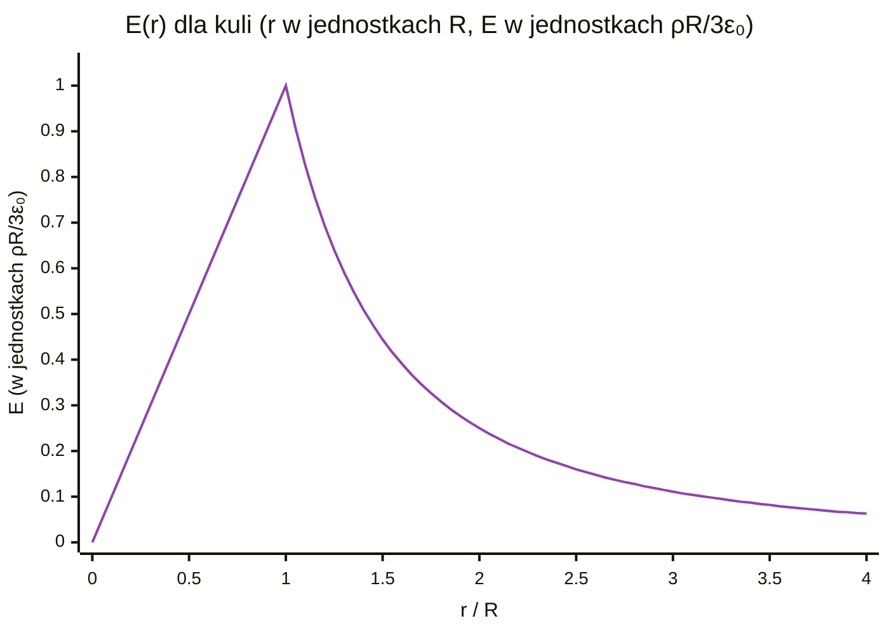

# Zestaw 2 – Cewki. Drgania i fale E-M (rozwiązania „krok po kroku”)

---

## Zadanie 1 – Obwód LC (idealny, bez oporu)

> [!note] Oznaczenia
> - $L$ – indukcyjność cewki [H], $C$ – pojemność kondensatora [F]
> - $q$ – ładunek na kondensatorze [C], $q_0$ – ładunek na początku
> - $I = \dot q$ – prąd (pochodna ładunku po czasie) [A]
> - $\omega_0$ – częstość kołowa drgań własnych [rad/s], $f$ – częstotliwość [Hz]
> - $N$ – liczba zwojów, $l$ – długość cewki, $r$ – promień cewki, $S$ – przekrój cewki
> - $d$ – grubość izolatora (odległość okładek), $S$ – pole okładki kondensatora
> - $\varepsilon_0 = 8{,}85\cdot10^{-12}\,\text{F/m}$ – przenikalność elektryczna próżni
> - $\varepsilon_r$ – przenikalność względna izolatora (ile razy lepszy niż próżnia)


### Co się dzieje?
Naładowany kondensator rozładowuje się przez cewkę → cewka „rozpędza” prąd → prąd ładuje kondensator w drugą stronę → i tak w kółko. Jak **huśtawka**: energia przelewa się między kondensatorem (pole E) a cewką (pole B).

### Kirchhoff
Napięcie na cewce + napięcie na kondensatorze = 0:
$$\color{royalblue} L\frac{dI}{dt} + \frac{q}{C} = 0,\qquad I = \frac{dq}{dt}$$
$$\color{royalblue} \Rightarrow \ddot q + \frac{1}{LC}q = 0$$

To jest równanie **oscylatora harmonicznego** (jak sprężyna: $\ddot x + \omega^2 x = 0$).

### Rozwiązanie
$$\color{royalblue} q(t) = q_0\cos(\omega_0 t),\qquad I(t) = \dot q = -q_0\omega_0\sin(\omega_0 t),\qquad \omega_0 = \frac{1}{\sqrt{LC}}$$

### Liczby
**Cewka:** $N = 100$, $l = 0{,}1\,\text{m}$, średnica $0{,}4\,\text{cm}$ → $r = 0{,}002\,\text{m}$, $S = \pi r^2 = 1{,}26\cdot10^{-5}\,\text{m}^2$
$$\color{royalblue} L = \frac{\mu_0 N^2 S}{l} = \frac{4\pi\cdot10^{-7}\cdot10^4\cdot1{,}26\cdot10^{-5}}{0{,}1} \approx 1{,}58\cdot10^{-6}\ \text{H}$$

**Kondensator:** $S = 1\,\text{cm}^2 = 10^{-4}\,\text{m}^2$, $d = 0{,}5\,\text{mm} = 5\cdot10^{-4}\,\text{m}$, $\varepsilon_r = 4$
$$\color{royalblue} C = \frac{\varepsilon_0\varepsilon_r S}{d} = \frac{8{,}85\cdot10^{-12}\cdot4\cdot10^{-4}}{5\cdot10^{-4}} \approx 7{,}1\cdot10^{-12}\ \text{F}$$

**Częstość:**
$$\color{royalblue} \omega_0 = \frac{1}{\sqrt{1{,}58\cdot10^{-6}\cdot7{,}1\cdot10^{-12}}} \approx 3\cdot10^{8}\ \text{rad/s},\qquad f = \frac{\omega_0}{2\pi} \approx 48\ \text{MHz}$$
(zakres radiowy UKF)

---

## Zadanie 2 – Obwód RLC (z oporem, gasnące drgania)

> [!note] Oznaczenia
> - $R$ – opór cewki [Ω], $L$ – indukcyjność [H], $C$ – pojemność [F]
> - $q$ – ładunek, $\dot q$ – prąd, $\ddot q$ – szybkość zmiany prądu
> - $\beta = R/(2L)$ – współczynnik tłumienia: jak szybko drgania gasną [1/s]
> - $\omega_0 = 1/\sqrt{LC}$ – częstość drgań bez oporu [rad/s]
> - $\omega$ – częstość drgań tłumionych (trochę mniejsza niż $\omega_0$) [rad/s]
> - $\lambda$ – pierwiastki równania charakterystycznego
> - $A, B, \varphi$ – stałe zależne od warunków początkowych


### Kirchhoff
$$\color{royalblue} L\ddot q + R\dot q + \frac{q}{C} = 0 \;\Rightarrow\; \ddot q + 2\beta\dot q + \omega_0^2 q = 0$$
$$\color{royalblue} \beta = \frac{R}{2L}\ (\text{tłumienie}),\qquad \omega_0^2 = \frac{1}{LC}$$

### Jak to rozwiązać?
Zgadujemy $q = e^{\lambda t}$ → równanie charakterystyczne:
$$\color{royalblue} \lambda^2 + 2\beta\lambda + \omega_0^2 = 0 \Rightarrow \lambda = -\beta \pm\sqrt{\beta^2 - \omega_0^2}$$

### Przypadek 1: małe $R$ ($\beta < \omega_0$) – drgania gasnące
$$\color{royalblue} q(t) = q_0 e^{-\beta t}\cos(\omega t + \varphi),\quad \omega = \sqrt{\omega_0^2 - \beta^2}$$
Prąd: $I = \dot q$ – też sinusoida z malejącą amplitudą $\sim e^{-\beta t}$.
> [!tip]
> Huśtawka w miodzie: buja się, ale coraz słabiej.



### Przypadek 2: duże $R$ ($\beta > \omega_0$, czyli $R > 2\sqrt{L/C}$) – brak drgań (przetłumienie)
$$\color{royalblue} q(t) = A e^{\lambda_1 t} + B e^{\lambda_2 t},\quad \lambda_{1,2} < 0$$
> [!tip]
> Kondensator po prostu powoli się rozładowuje, bez przechodzenia na drugą stronę.

### Przypadek graniczny ($\beta = \omega_0$, $R = 2\sqrt{L/C}$) – tłumienie krytyczne
$$\color{royalblue} q(t) = q_0(1 + \beta t)e^{-\beta t}$$
> [!tip]
> Najszybszy powrót do zera bez drgań.

---

## Zadanie 3* – Symulator RLC z wymuszeniem

> [!note] Oznaczenia
> - $U_0$ – amplituda napięcia źródła [V]
> - $\Omega$ – częstość kołowa źródła (wymuszenia) [rad/s]
> - $Z$ – impedancja, czyli „opór zastępczy” całego obwodu [Ω]
> - $I_0$ – amplituda prądu po ustabilizowaniu [A]
> - $\varphi$ – przesunięcie fazowe prądu względem napięcia
> - $\omega_0 = 1/\sqrt{LC}$ – częstość rezonansowa [rad/s]
> - $\Delta t$ – krok czasu w symulacji [s]


### Równanie
$$\color{royalblue} L\frac{dI}{dt} + RI + \frac{q}{C} = U_0\sin(\Omega t)$$

### Metoda (Euler – „krok po kroku w czasie”)
Dzielimy czas na malutkie kroki $\Delta t$. W każdym kroku:
1. liczymy, jak szybko zmienia się prąd: $\dfrac{dI}{dt} = \dfrac{U(t) - RI - q/C}{L}$
2. $I \leftarrow I + \dfrac{dI}{dt}\Delta t$
3. $q \leftarrow q + I\,\Delta t$
4. $t \leftarrow t + \Delta t$

### Kod (Python)
```python
import numpy as np
import matplotlib.pyplot as plt

L, R, C = 1e-3, 10.0, 1e-6       # H, Ω, F
U0, f = 1.0, 3000.0               # V, Hz
W = 2*np.pi*f
dt = 1e-8
N = int(0.02/dt)                  # 20 ms symulacji

q, I = 0.0, 0.0
t_arr, I_arr, U_arr = [], [], []
for n in range(N):
    t = n*dt
    U = U0*np.sin(W*t)
    dIdt = (U - R*I - q/C)/L
    I += dIdt*dt          # Euler półjawny (stabilniejszy)
    q += I*dt
    if n % 100 == 0:
        t_arr.append(t); I_arr.append(I); U_arr.append(U)

t_arr, I_arr = np.array(t_arr), np.array(I_arr)
# amplituda w stanie ustalonym (ostatnie 20% czasu)
tail = t_arr > 0.8*t_arr[-1]
I0_sim = I_arr[tail].max()

Z = np.sqrt(R**2 + (W*L - 1/(W*C))**2)
phi = np.degrees(np.arctan((W*L - 1/(W*C))/R))
print(f"I0 symulacja = {I0_sim:.4f} A, teoria = {U0/Z:.4f} A, faza = {phi:.1f}°")

plt.plot(t_arr, I_arr, label="I(t)")
plt.plot(t_arr, np.array(U_arr)*I0_sim/U0, "--", label="U(t) (przeskalowane)")
plt.legend(); plt.xlabel("t [s]"); plt.show()
```

### Analiza (co powinno wyjść po ustabilizowaniu)
- Na początku jest „bałagan” (stan przejściowy), potem prąd drga z częstotliwością **źródła**.
- **Amplituda:**
$$\color{royalblue} I_0 = \frac{U_0}{Z},\quad Z = \sqrt{R^2 + \left(\Omega L - \frac{1}{\Omega C}\right)^2}$$
- **Faza** (o ile prąd spóźnia się za napięciem):
$$\color{royalblue} \tan\varphi = \frac{\Omega L - \frac{1}{\Omega C}}{R}$$
  - $\Omega < \omega_0$ → dominuje kondensator → prąd **wyprzedza** napięcie
  - $\Omega > \omega_0$ → dominuje cewka → prąd **spóźnia się**
  - $\Omega = \omega_0 = \dfrac{1}{\sqrt{LC}}$ → **rezonans**: $Z = R$, prąd max, faza 0.

Wykonaj symulację dla kilku $f$ i narysuj $I_0(f)$ – wyjdzie krzywa rezonansowa (pik przy $f_0$).

---

## Zadanie 4 – Fala rentgenowska

> [!note] Oznaczenia
> - $E_0$ – amplituda pola elektrycznego [V/m]
> - $k$ – wektor falowy (liczba falowa) [m⁻¹]
> - $x$ – położenie [m], $t$ – czas [s]
> - $\lambda$ – długość fali [m]
> - $\omega$ – częstość kołowa [rad/s], $T$ – okres [s]
> - $c = 3\cdot10^{8}\,\text{m/s}$ – prędkość światła
> - $\Delta x$ – przesunięcie, o które zmienia się faza [m]


$E = E_0\sin(kx - \omega t)$, $k = 10^{10}\,\text{m}^{-1}$.

| Wielkość | Wzór | Wynik |
|---|---|---|
| Długość fali | $\lambda = \dfrac{2\pi}{k}$ | $6{,}28\cdot10^{-10}\,\text{m} \approx 0{,}63\,\text{nm}$ |
| Częstość | $\omega = ck$ | $3\cdot10^{8}\cdot10^{10} = 3\cdot10^{18}\,\text{rad/s}$ |
| Okres | $T = \dfrac{2\pi}{\omega}$ | $2{,}1\cdot10^{-18}\,\text{s}$ |
| Przesunięcie dla zmiany fazy o $90^\circ$ | $\Delta x = \dfrac{\pi/2}{k} = \dfrac{\lambda}{4}$ | $1{,}57\cdot10^{-10}\,\text{m}$ |

> [!tip]
> Faza to $\color{teal}{kx - \omega t}$. Żeby zmieniła się o $\color{teal}{\pi/2}$, przesuwamy $\color{teal}{x}$ o $\color{teal}{\dfrac{\pi}{2k}}$.

---

## Zadanie 5 – Pole naładowanej kuli (prawo Gaussa)

> [!note] Oznaczenia
> - $\rho$ – gęstość objętościowa ładunku (ładunek na 1 m³) [C/m³]
> - $R$ – promień kuli [m], $r$ – odległość od środka kuli [m]
> - $Q_{wewn}$ – ładunek wewnątrz wybranej sfery Gaussa [C]
> - $E$ – natężenie pola elektrycznego [V/m]
> - $d\vec S$ – mały kawałek powierzchni (wektor prostopadły do niej)
> - $\varepsilon_0$ – przenikalność elektryczna próżni


### Prawo Gaussa
$$\color{royalblue} \oint \vec E\cdot d\vec S = \frac{Q_{wewn}}{\varepsilon_0}$$
„Strumień pola przez zamkniętą powierzchnię = ładunek w środku / $\varepsilon_0$”.

Bierzemy **sferę o promieniu $r$** (współśrodkową). Z symetrii $E$ jest radialne i takie samo na całej sferze → lewa strona $= E\cdot4\pi r^2$.

### $r > R$ (na zewnątrz)
W środku jest cały ładunek: $Q = \rho\cdot\frac43\pi R^3$
$$\color{royalblue} E\cdot4\pi r^2 = \frac{\rho\frac43\pi R^3}{\varepsilon_0} \Rightarrow \boxed{\color{orange}E = \frac{\rho R^3}{3\varepsilon_0 r^2}}$$
(jak ładunek punktowy)

### $r < R$ (w środku)
W środku tylko część: $Q = \rho\cdot\frac43\pi r^3$
$$\color{royalblue} E\cdot4\pi r^2 = \frac{\rho\frac43\pi r^3}{\varepsilon_0} \Rightarrow \boxed{\color{orange}E = \frac{\rho r}{3\varepsilon_0}}$$
(rośnie liniowo)



---

## Zadanie 6 – Dywergencja i rotacja tego pola

> [!note] Oznaczenia
> - $E_r$ – składowa pola skierowana od środka (radialna)
> - $E_\theta, E_\varphi$ – składowe „boczne” (tu równe 0)
> - $\nabla\cdot\vec E$ – dywergencja: czy w danym miejscu pole ma źródło (ładunek)
> - $\nabla\times\vec E$ – rotacja: czy pole „kręci się w kółko”
> - $\theta, \varphi$ – kąty w układzie sferycznym


Pole ma tylko składową radialną $E_r(r)$. W układzie sferycznym:
$$\color{royalblue} \nabla\cdot\vec E = \frac{1}{r^2}\frac{\partial}{\partial r}\left(r^2 E_r\right)$$

### Wewnątrz ($E = \dfrac{\rho r}{3\varepsilon_0}$)
$$\color{royalblue} \nabla\cdot\vec E = \frac{1}{r^2}\frac{d}{dr}\left(\frac{\rho r^3}{3\varepsilon_0}\right) = \frac{1}{r^2}\cdot\frac{\rho r^2}{\varepsilon_0} = \boxed{\color{orange}\frac{\rho}{\varepsilon_0}}$$
✔ Zgadza się z I równaniem Maxwella.

### Na zewnątrz ($E = \dfrac{\rho R^3}{3\varepsilon_0 r^2}$)
$$\color{royalblue} r^2 E_r = \text{const} \Rightarrow \nabla\cdot\vec E = \boxed{\color{orange}0}$$
✔ Nie ma tam ładunku.

### Rotacja
Rotacja w sferycznych zawiera tylko pochodne $E_\theta, E_\varphi$ oraz pochodne $E_r$ po kątach $\theta, \varphi$. Tu $E_\theta = E_\varphi = 0$, a $E_r$ zależy tylko od $r$ → **wszystko się zeruje**:
$$\color{royalblue} \nabla\times\vec E = 0\quad \text{(wewnątrz i na zewnątrz)}$$
> [!tip]
> Pole elektrostatyczne jest bezwirowe (zachowawcze).

---

## Zadanie 7 – Równania Maxwella

> [!note] Oznaczenia
> - $\vec E$ – pole elektryczne [V/m], $\vec B$ – pole magnetyczne [T]
> - $\rho$ – gęstość ładunku [C/m³], $\vec j$ – gęstość prądu [A/m²]
> - $Q$ – ładunek [C], $I$ – prąd [A]
> - $\Phi_E, \Phi_B$ – strumienie pola elektrycznego i magnetycznego
> - $d\vec S$ – kawałek powierzchni, $d\vec l$ – kawałek krzywej
> - $\varepsilon_0, \mu_0$ – stałe próżni (elektryczna i magnetyczna)


| # | Całkowa | Różniczkowa | Po ludzku |
|---|---|---|---|
| I (Gauss E) | $\oint \vec E\cdot d\vec S = \dfrac{Q}{\varepsilon_0}$ | $\nabla\cdot\vec E = \dfrac{\rho}{\varepsilon_0}$ | ładunki są źródłami pola E |
| II (Gauss B) | $\oint \vec B\cdot d\vec S = 0$ | $\nabla\cdot\vec B = 0$ | nie ma „ładunków magnetycznych”, linie B są zamknięte |
| III (Faraday) | $\oint \vec E\cdot d\vec l = -\dfrac{d\Phi_B}{dt}$ | $\nabla\times\vec E = -\dfrac{\partial\vec B}{\partial t}$ | zmienne B robi wirowe E |
| IV (Ampère–Maxwell) | $\oint \vec B\cdot d\vec l = \mu_0 I + \mu_0\varepsilon_0\dfrac{d\Phi_E}{dt}$ | $\nabla\times\vec B = \mu_0\vec j + \mu_0\varepsilon_0\dfrac{\partial\vec E}{\partial t}$ | prąd i zmienne E robią wirowe B |

### Prąd przesunięcia
Człon $\varepsilon_0\dfrac{\partial\vec E}{\partial t}$ (gęstość) / $\varepsilon_0\dfrac{d\Phi_E}{dt}$ (prąd). Dodany przez Maxwella.
Przykład: kondensator ładowany prądem – między okładkami **nie płyną elektrony**, ale zmienia się pole E i to „działa jak prąd”, wytwarzając pole B. Bez tego członu **nie byłoby fal EM**.

### W próżni (fala EM)
Brak ładunków i prądów: $\rho = 0$, $\vec j = 0$ (czyli $Q = 0$, $I = 0$). Zostaje:
$$\color{royalblue} \nabla\cdot\vec E = 0,\quad \nabla\cdot\vec B = 0,\quad \nabla\times\vec E = -\frac{\partial\vec B}{\partial t},\quad \nabla\times\vec B = \mu_0\varepsilon_0\frac{\partial\vec E}{\partial t}$$

---

## Zadanie 8 – Wyprowadzenie równania falowego

> [!note] Oznaczenia
> - $\nabla\times$ – rotacja, $\nabla\cdot$ – dywergencja
> - $\nabla^2$ – laplasjan: suma drugich pochodnych po $x, y, z$
> - $\vec A, \vec B, \vec C$ – dowolne wektory w tożsamości
> - $v$ – prędkość fali [m/s], $c$ – prędkość światła


Tożsamość: $\vec A\times(\vec B\times\vec C) = \vec B(\vec A\cdot\vec C) - \vec C(\vec A\cdot\vec B)$, dla nabli:
$$\color{royalblue} \nabla\times(\nabla\times\vec E) = \nabla(\nabla\cdot\vec E) - \nabla^2\vec E$$

**Krok 1.** Bierzemy rotację z III równania:
$$\color{royalblue} \nabla\times(\nabla\times\vec E) = -\frac{\partial}{\partial t}(\nabla\times\vec B)$$

**Krok 2.** Lewa strona z tożsamości, a $\nabla\cdot\vec E = 0$ (próżnia):
$$\color{royalblue} \text{lewa} = -\nabla^2\vec E$$

**Krok 3.** Prawa strona – wstawiamy IV równanie:
$$\color{royalblue} \text{prawa} = -\frac{\partial}{\partial t}\left(\mu_0\varepsilon_0\frac{\partial\vec E}{\partial t}\right) = -\mu_0\varepsilon_0\frac{\partial^2\vec E}{\partial t^2}$$

**Wynik:**
$$\color{royalblue} \boxed{\color{orange}\nabla^2\vec E = \mu_0\varepsilon_0\frac{\partial^2\vec E}{\partial t^2}}$$
To jest równanie falowe $\nabla^2 f = \dfrac{1}{v^2}\dfrac{\partial^2 f}{\partial t^2}$ z $v = \dfrac{1}{\sqrt{\mu_0\varepsilon_0}} = c$. (Dla B identycznie.)

---

## Zadanie 9 – Czy $\vec E = \hat j E_0\sin(\omega t - kx)$ spełnia równanie falowe?

> [!note] Oznaczenia
> - $\hat j$ – wektor jednostkowy osi $y$ (pole E drga wzdłuż $y$)
> - $E_0$ – amplituda [V/m], $\omega$ – częstość kołowa, $k$ – liczba falowa
> - $v = \omega/k$ – prędkość fali [m/s]
> - $\varepsilon_r, \mu_r$ – przenikalności względne ośrodka (w próżni równe 1)


$E$ zależy tylko od $x$ i $t$, więc $\nabla^2 E = \dfrac{\partial^2 E}{\partial x^2}$.

$$\color{royalblue} \frac{\partial^2 E}{\partial x^2} = -k^2 E_0\sin(\omega t - kx),\qquad \frac{\partial^2 E}{\partial t^2} = -\omega^2 E_0\sin(\omega t - kx)$$

Wstawiamy:
$$\color{royalblue} -k^2 E = \mu_0\varepsilon_0(-\omega^2 E) \Rightarrow k^2 = \mu_0\varepsilon_0\omega^2$$

✔ Spełnia, **pod warunkiem** że $\dfrac{\omega}{k} = \dfrac{1}{\sqrt{\mu_0\varepsilon_0}}$.

### Prędkość fali
$$\color{royalblue} v = \frac{\omega}{k} = \frac{1}{\sqrt{\mu_0\varepsilon_0}} = c \approx 3\cdot10^8\ \text{m/s}$$
W ośrodku: $v = \dfrac{1}{\sqrt{\mu_0\mu_r\varepsilon_0\varepsilon_r}} = \dfrac{c}{\sqrt{\mu_r\varepsilon_r}}$ → zależy **tylko od własności ośrodka** (przenikalności elektrycznej i magnetycznej), nie od amplitudy.

---

## Zadanie 10 – Pole B dla $\vec E = \hat j E_0\sin(\omega t - kx)$

> [!note] Oznaczenia
> - $\hat i, \hat j, \hat k$ – wektory jednostkowe osi $x, y, z$
> - $E_y$ – składowa pola elektrycznego, $B_z$ – składowa pola magnetycznego
> - $B_0 = E_0/c$ – amplituda pola magnetycznego [T]
> - $\vec S$ – wektor Poyntinga: ile energii fala niesie przez 1 m² w 1 s [W/m²]


**Krok 1. Rotacja E.** Jest tylko $E_y(x,t)$:
$$\color{royalblue} \nabla\times\vec E = \hat k\,\frac{\partial E_y}{\partial x} = \hat k\,(-kE_0\cos(\omega t - kx))$$

**Krok 2. Faraday:** $\nabla\times\vec E = -\dfrac{\partial\vec B}{\partial t}$
$$\color{royalblue} \frac{\partial B_z}{\partial t} = kE_0\cos(\omega t - kx)$$

**Krok 3. Całkujemy po czasie:**
$$\color{royalblue} B_z = \frac{k}{\omega}E_0\sin(\omega t - kx) = \frac{E_0}{c}\sin(\omega t - kx)$$
$$\color{royalblue} \boxed{\color{orange}\vec B = \hat k\,\frac{E_0}{c}\sin(\omega t - kx)}$$

> [!tip]
> $\color{teal}{\vec B}$ jest **prostopadłe do $\color{teal}{\vec E}$** ($\color{teal}{z}$ vs $\color{teal}{y}$), drga **w fazie** z $\color{teal}{E}$, i jest $\color{teal}{c}$ razy „mniejsze”: $\color{teal}{B_0 = \dfrac{E_0}{c}}$.

### Iloczyn $\vec E\times\vec B$
$$\color{royalblue} \vec E\times\vec B = \frac{E_0^2}{c}\sin^2(\omega t - kx)\,(\hat j\times\hat k) = \frac{E_0^2}{c}\sin^2(\omega t - kx)\,\hat i$$

- **Proporcjonalny do $E_0^2$** (kwadrat amplitudy) – czyli do natężenia/energii fali.
- **Kierunek: oś $x$, zwrot: $+x$** – w stronę, w którą biegnie fala.
- $\vec S = \dfrac{1}{\mu_0}\vec E\times\vec B$ to **wektor Poyntinga** = gęstość strumienia energii (W/m²).
